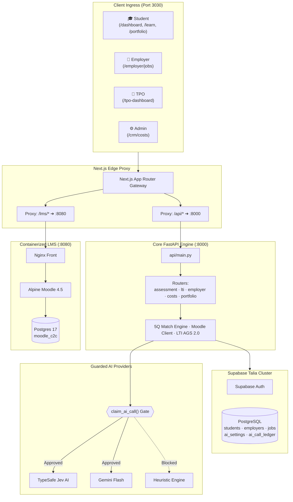
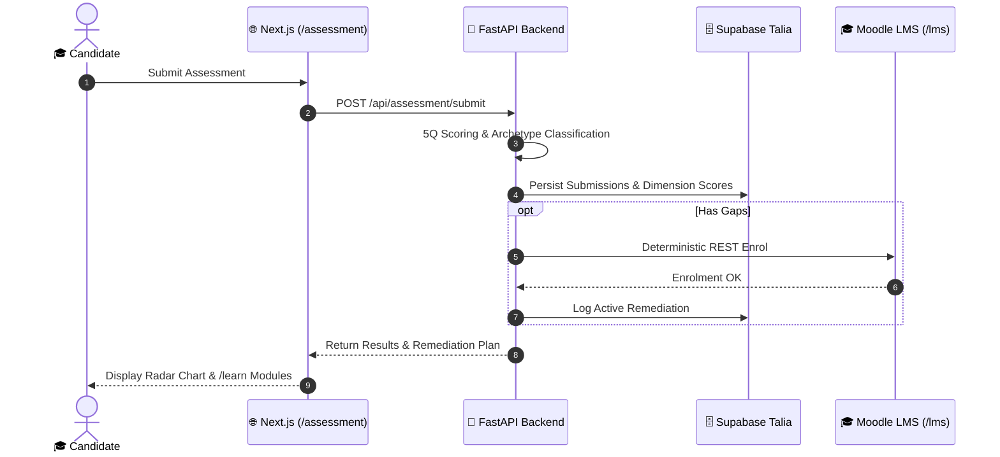
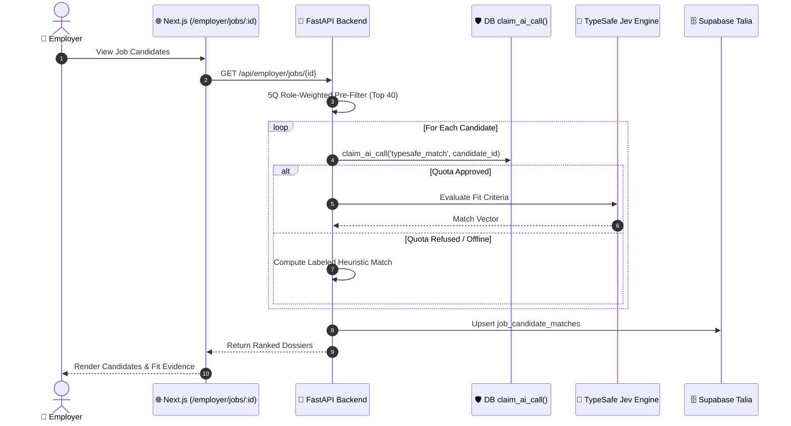

# Campus to Corporate (C2C) 👔
## Unified AI-First Talent Evaluation, Remediation & Placement Suite

> **"Bridging technical competence, 5Q developmental readiness, and automated career placement with deterministic AI cost controls."**

---

## 📑 Architecture & Process Navigation

*   📖 **High-Level Design (HLD)**: [`c2c_hld.md`](file:///C:/tt-ai-stack/01_projects/active/makeover-talent-agency/c2c_hld.md) — Multi-tier topology, block diagrams, edge proxy ingress, security boundary, and 4-reviewer board review.
*   🔬 **Low-Level Design (LLD)**: [`c2c_lld.md`](file:///C:/tt-ai-stack/01_projects/active/makeover-talent-agency/c2c_lld.md) — Detailed class/function signatures, PostgreSQL DDL schemas, API JSON contracts, state machines, and failure recovery policies for all 9 platform processes.
*   📚 **Enterprise Wiki & Confluence Hub**: [`WIKI_ARCHITECTURE.md`](file:///C:/tt-ai-stack/01_projects/active/makeover-talent-agency/WIKI_ARCHITECTURE.md) — Confluence space hierarchy, MOC hub-and-spoke layout, persona portals, search taxonomy, and Docs-as-Code pipeline.
*   ⚙️ **Master Workflow SOP**: [`WORKFLOW_INTEGRATION.md`](file:///C:/tt-ai-stack/01_projects/active/makeover-talent-agency/WORKFLOW_INTEGRATION.md) — Standard operating procedures uniting discovery, audit, assessment, refinement, and launch.
*   🚀 **Go-Live Readiness Audit**: [`GO_LIVE.md`](file:///C:/tt-ai-stack/01_projects/active/makeover-talent-agency/GO_LIVE.md) — Current release blockers, environment verification, and production readiness proof.

---

## 🏛️ High-Level Design (HLD) Overview

C2C operates as a cohesive, multi-tenant monolith with containerized edge extensions:
1. **Presentation & Edge Layer**: Next.js 14 App Router (Port 3030) serving student, employer, TPO, and admin interfaces, while transparently reverse-proxying `/lms/*` to internal port 8080 and `/api/*` to FastAPI.
2. **Application Core Engine**: FastAPI REST backend (Port 8000 / Vercel Serverless) orchestrating 5Q scoring, LTI 1.3 Advantage protocols, employer candidate matching, and PDF generation.
3. **Isolated Learning Subsystem**: Alpine Moodle 4.5+ and PostgreSQL 17 running on Docker bridge (`c2c-lms-net`), ensuring zero schema contamination on primary business tables.
4. **Guarded AI Integration**: TypeSafe Jev (candidate featurization/matching) and Google Gemini Flash (market opportunity sourcing and question item generation), strictly governed by pre-flight database quota claims (`claim_ai_call`).



---

## 🔬 Low-Level Design (LLD): Process & Workflow Catalog

| # | Process Name | Router / Script | DB Tables / Storage | AI Quota Source | Fallback Mechanism |
|:---:|---|---|---|---|---|
| **P1** | **Candidate Assessment & 5Q Scoring** | `api/routers/assessment_router.py` | `psychometric_items`, `assessment_submissions`, `dimension_scores` | *None (Deterministic)* | Standardized item scoring algorithms |
| **P2** | **Zero-Token Gap Remediation** | `api/services/moodle_client.py` | Isolated DB `moodle_c2c` | *Zero Token (Deterministic REST)* | Direct curriculum roadmap in `/learn` |
| **P3** | **LTI 1.3 Gateway & AGS 2.0 Passback** | `api/routers/lti_router.py`, `api/services/lti_ags.py` | `lti_deployments`, `student_grades` | *None (Cryptographic RSA256)* | Local session auth redirect |
| **P4** | **Employer Matching & Decisions** | `api/routers/employer_router.py`, `services/matching/scorer.py` | `job_postings`, `job_candidate_matches` | `typesafe_match` (Cap: 200/day) | Labeled heuristic estimate (`is_live_api: false`) |
| **P5** | **AI Cost Ledger & Spend Controls** | `api/routers/costs_router.py`, `api/services/ai_budget.py` | `ai_settings`, `ai_call_ledger` | System Governor | Rejection of unmetered calls (HTTP 429/Fallback) |
| **P6** | **Market Scout Headless Pipeline** | `services/market-scout/scraper/main.py` | `public.jobs` | `gemini_scout` (Cap: 60/day) | Regex parser & neutral score (50) |
| **P7** | **Assessment Item Generation** | `api/item_generator.py` | `public.psychometric_items` | `gemini_item_gen` (Cap: 50/day) | Static backup bank (`api/fallback_bank.json`) |
| **P8** | **Retro Portfolio & Dossier Export** | `api/routers/portfolio_router.py`, `api/pdf_generator.py` | `students`, Supabase Storage | *None (Local ReportLab)* | Plain-text résumé / JSON export |
| **P9** | **Multi-Tenant Ingress & Demo Guard** | `api/deps.py`, `src/app/auth` | `auth.users`, role profiles | *None (JWT / RLS)* | Redirect to `/login` |

*Complete technical DDL, function signatures, and JSON schemas are specified in [`c2c_lld.md`](file:///C:/tt-ai-stack/01_projects/active/makeover-talent-agency/c2c_lld.md).*

---

## 🗺️ Application-to-Workflow Relationship Matrix

Every action across the platform maps deterministically to specific code entrypoints, UI routes, database tables, and AI cost controls:

| Workflow ID & Name | Triggering UI Route | Backend Router & Services | Primary Database Entities | AI Quota Source & Cap | Downstream Outcome |
|---|---|---|---|---|---|
| **WF-1: Candidate Assessment & Gap Extraction** | [`/assessment`](file:///C:/tt-ai-stack/01_projects/active/makeover-talent-agency/src/app/(main)/assessment/page.tsx) | [`assessment_router.py`](file:///C:/tt-ai-stack/01_projects/active/makeover-talent-agency/api/routers/assessment_router.py), [`scorer.py`](file:///C:/tt-ai-stack/01_projects/active/makeover-talent-agency/services/matching/scorer.py) | `psychometric_items`, `assessment_submissions`, `dimension_scores` | *Deterministic (0 Tokens)* | 5Q quotients (IQ, AQ, EQ, SQ, SpQ) stored; archetype calculated; gaps flagged. |
| **WF-2: Zero-Token LMS Course Enrolment** | Automated trigger from WF-1 | [`moodle_client.py`](file:///C:/tt-ai-stack/01_projects/active/makeover-talent-agency/api/services/moodle_client.py), [`lti_router.py`](file:///C:/tt-ai-stack/01_projects/active/makeover-talent-agency/api/routers/lti_router.py) | Isolated Docker DB `moodle_c2c` (Postgres 17) | *Deterministic REST (0 Tokens)* | Student registered in Moodle courses (`C2C-PY-102`, etc.); displayed on [`/learn`](file:///C:/tt-ai-stack/01_projects/active/makeover-talent-agency/src/app/(main)/learn/page.tsx). |
| **WF-3: LTI 1.3 Grade Passback & Mastery** | Quiz completion in [`/lms`](file:///C:/tt-ai-stack/01_projects/active/makeover-talent-agency/services/lms) | [`lti_router.py`](file:///C:/tt-ai-stack/01_projects/active/makeover-talent-agency/api/routers/lti_router.py), [`lti_ags.py`](file:///C:/tt-ai-stack/01_projects/active/makeover-talent-agency/api/services/lti_ags.py) | `lti_deployments`, `student_grades`, `students` | *Cryptographic RSA256* | AGS 2.0 grade synchronized to Supabase; student skill gap resolved on radar. |
| **WF-4: Employer Job Posting & Candidate Matching** | [`/employer/jobs/[id]`](file:///C:/tt-ai-stack/01_projects/active/makeover-talent-agency/src/app/employer/jobs/[id]/page.tsx) | [`employer_router.py`](file:///C:/tt-ai-stack/01_projects/active/makeover-talent-agency/api/routers/employer_router.py), [`typesafe_service.py`](file:///C:/tt-ai-stack/01_projects/active/makeover-talent-agency/api/services/typesafe_service.py) | `job_postings`, `job_candidate_matches` | `typesafe_match` (Cap: 200/d) | Top 40 pre-filtered via 5Q weights; deep match via TypeSafe or heuristic fallback. |
| **WF-5: AI Cost Control & Pre-Flight Ledger** | Every billable LLM invocation | [`costs_router.py`](file:///C:/tt-ai-stack/01_projects/active/makeover-talent-agency/api/routers/costs_router.py), [`ai_budget.py`](file:///C:/tt-ai-stack/01_projects/active/makeover-talent-agency/api/services/ai_budget.py) | `ai_settings`, `ai_call_ledger` | System Financial Governor | Pre-execution lock via `claim_ai_call()`; live stats rendered on [`/crm/costs`](file:///C:/tt-ai-stack/01_projects/active/makeover-talent-agency/src/app/crm/costs/page.tsx). |
| **WF-6: Market Scout Sourcing Pipeline** | Background daemon / GitHub Action | `services/market-scout/scraper/main.py`, `ai/pipeline.py` | `public.jobs`, `market_entities` | `gemini_scout` (Cap: 60/d) | Headless scrape (HN/RemoteOK) deduplicated; Gemini scores and syncs vacancies. |
| **WF-7: Psychometric Item Generation** | Admin console / CLI script | [`item_generator.py`](file:///C:/tt-ai-stack/01_projects/active/makeover-talent-agency/api/item_generator.py) | `public.psychometric_items` | `gemini_item_gen` (Cap: 50/d) | Gemini generates questions with fallback to [`fallback_bank.json`](file:///C:/tt-ai-stack/01_projects/active/makeover-talent-agency/api/fallback_bank.json). |
| **WF-8: Student Retro Portfolio & Dossier** | [`/portfolio/[id]`](file:///C:/tt-ai-stack/01_projects/active/makeover-talent-agency/src/app/portfolio/[id]/page.tsx) | [`portfolio_router.py`](file:///C:/tt-ai-stack/01_projects/active/makeover-talent-agency/api/routers/portfolio_router.py), [`pdf_generator.py`](file:///C:/tt-ai-stack/01_projects/active/makeover-talent-agency/api/pdf_generator.py) | `students`, Supabase Storage | *Deterministic ReportLab* | Interactive Windows 95 desktop, DOS query terminal, and signed PDF dossier. |
| **WF-9: Institutional Cohort Analytics** | [`/tpo-dashboard/[id]`](file:///C:/tt-ai-stack/01_projects/active/makeover-talent-agency/src/app/tpo-dashboard/[id]/page.tsx) | [`analytics_router.py`](file:///C:/tt-ai-stack/01_projects/active/makeover-talent-agency/api/routers/analytics_router.py), Realtime channel | `students`, `assessments`, `institutions` | *Deterministic SQL Aggregation* | National quotient benchmarks, risk alerts, and placement funnel updates. |

---

## 🔄 Core System Workflows

### Workflow 1: Assessment Submission, 5Q Scoring & Remediation Sync
1. Student submits Likert, Situational Judgment Test (SJT), and Cognitive answers to `POST /api/assessment/submit`.
2. Router parses scoring logic via `parse_scoring_logic()` and normalizes quotients [0-100] across IQ, AQ, EQ, SQ, and SpQ.
3. Cognitive archetype (`THE_BUILDER`, `THE_LEADER`, or `THE_ANCHOR`) is determined; deficient competencies (<60%) are tagged as gaps.
4. If gaps exist, `MoodleClient.auto_remediate_gaps()` invokes Moodle REST API (`enrol_manual_enrol_users`) to enrol the student in corresponding modules (`C2C-PY-102`, `C2C-DB-201`) with **zero LLM tokens**.
5. Assessment results and remediation links are immediately returned to the student dashboard and `/learn` terminal.



---

### Workflow 2: LTI 1.3 Advantage Launch & AGS 2.0 Grade Passback
1. Candidate launches an embedded learning activity from `/learn` into `/lms`.
2. Moodle initiates OpenID Connect handshake via `GET /api/lti/login`.
3. FastAPI responds with 302 redirect carrying `state` and `nonce`.
4. Moodle posts signed LTI JWT launch token to `POST /api/lti/launch`.
5. FastAPI verifies cryptographic signature against rotating RSA public keys (`GET /api/lti/jwks`).
6. Upon completing quizzes/tasks in Moodle, Moodle issues AGS 2.0 passback to `POST /api/lti/grade-passback`.
7. Student development record and verified skills are automatically updated in Supabase.

---

### Workflow 3: Employer Candidate Ranking & Cost-Guarded Evaluation
1. Employer accesses job candidate console (`/employer/jobs/[id]`).
2. FastAPI fetches all candidate quotients and performs **Tier-1 Deterministic 5Q Ranking** weighted by job profile (e.g., Technical: 40% IQ, 30% AQ, 20% EQ, 5% SQ, 5% SpQ).
3. The top 40 candidates enter **Tier-2 Deep Evaluation**.
4. For each candidate, the engine calls database RPC `claim_ai_call('typesafe_match', candidate_id)`.
5. **Approved Quota**: TypeSafe Jev evaluates deep requirement alignment; result persisted with `is_live_api=True`.
6. **Exhausted / Missing Quota**: System fails closed to labeled heuristic match (`is_live_api=False`, provider "Heuristic estimate") without blocking the recruiter.
7. Employer reviews candidates, requests introductions, or marks decisions (`SHORTLISTED`, `INTERVIEWING`, `OFFERED`, `REJECTED`) with full audit rollback.



---

### Workflow 4: Market Scout Opportunity Ingestion
1. Headless daemon executes scheduled scrape across HackerNews Hiring and RemoteOK.
2. Content hash deduplication checks ensure zero redundant job entries.
3. Scraper claims quota via `claim_ai_call('gemini_scout')`.
4. Gemini Flash extracts role requirements, tech stacks, and opportunity scores.
5. Ingested opportunities sync directly to `public.jobs` in Supabase Talia.

---

## 💻 Local Development Setup

### 1. Prerequisites
*   Node.js 18+ and npm
*   Python 3.12+ with virtual environment
*   Docker Desktop (for LMS co-location)
*   PowerShell 7 / Bash

### 2. Start LMS Subsystem
```bash
cd services/lms
docker compose up -d
cd ../..
```

### 3. Start C2C Web & API Services
```bash
# Installs dependencies & runs Next.js (port 3030) + FastAPI (port 8000) concurrently
npm run start:c2c
```

Access local endpoints:
*   **Web Portal**: [http://localhost:3030](http://localhost:3030)
*   **Remediation Terminal**: [http://localhost:3030/learn](http://localhost:3030/learn)
*   **Embedded Moodle LMS**: [http://localhost:3030/lms](http://localhost:3030/lms)
*   **FastAPI Documentation**: [http://127.0.0.1:8000/docs](http://127.0.0.1:8000/docs)
*   **AI Cost Governance**: [http://localhost:3030/crm/costs](http://localhost:3030/crm/costs)

---

## 🧪 Verification Commands

```bash
# Backend unit & integration test suite
python -m pytest tests -q --ignore=tests/e2e --ignore=tests/e2e_flow_test.py

# TypeScript static type check
npx tsc --noEmit

# Frontend linter & production build verification
npm run lint
npm run build
```

---

## 🚢 Production Deployment

*   **Frontend**: Vercel App Router deployment (`c2c.mytestbed.tech`).
*   **Backend**: Serverless execution of `api/main.py` via `vercel.json` rewrites.
*   **Database**: Supabase PostgreSQL with transaction pooling (`port 6543`).
*   **Security Guard**: `ALLOW_DEMO_AUTH=false` and `NEXT_PUBLIC_ALLOW_DEMO_AUTH=false` strictly enforced in production.
