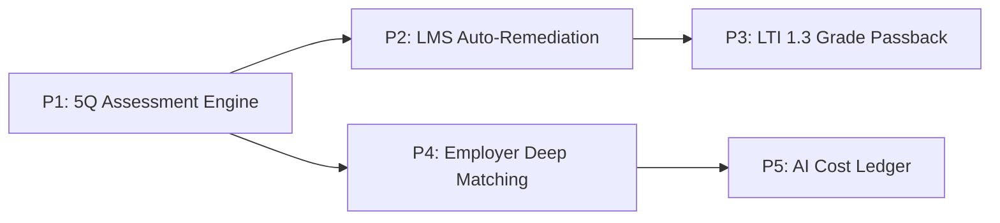
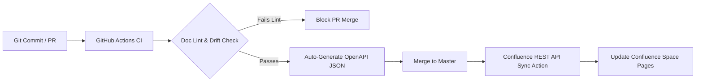

# Campus-to-Corporate (C2C) — Enterprise Wiki & Confluence Architecture

---

## 1. Executive Summary & Information Architecture Vision

This document defines the official enterprise knowledge base architecture for the **Campus-to-Corporate (C2C)** platform. It resolves cognitive friction between the platform's three core models—**Personas** (Student, Employer, TPO, Admin), **5-Phase Lifecycle** (Signal, Audit, Ordeal, Fix, Win), and **9 Engineering Processes** (P1–P9)—by deploying a **Map of Content (MOC)** hub-and-spoke topology with progressive disclosure.

```text
┌────────────────────────────────────────────────────────────────────────────────────────┐
│                              C2C WIKI TOPOLOGY (MOC)                                   │
├───────────────────────────┬──────────────────────────────┬─────────────────────────────┤
│ 🏠 00. Master Home Portal │ 🧭 01. Strategy & Lifecycles │ 🏛️ 02. System Topology (HLD)│
│ 🔬 03. LLD & Tech Specs   │ 🔄 04. Master SOPs           │ 👥 05. Persona Playbooks    │
│ 🛠️ 06. Engineering & Ops  │ 🛡️ 07. Governance & Security │ 📑 08. ADRs & Board Reviews │
└───────────────────────────┴──────────────────────────────┴─────────────────────────────┘
```

---

## 2. Confluence Space Hierarchy & Page Tree

*   **Space Key**: `C2C`
*   **Space Name**: `Campus to Corporate (C2C) — Engineering & Operations Wiki`
*   **Primary Ingress**: `c2c.mytestbed.tech` / `localhost:3030`

```text
C2C Space Root (🏠 Master Portal / Home Page)
│
├── 📂 01. Platform Strategy & Overview
│   ├── 📄 Executive Summary & Product Axioms
│   ├── 📄 5-Phase Candidate Lifecycle (Signal ➔ Audit ➔ Ordeal ➔ Fix ➔ Win)
│   ├── 📄 Value Proposition Matrix (Student, Employer, TPO, Admin)
│   └── 📄 Product KPIs, Unit Economics & Budget Ceilings
│
├── 📂 02. System Architecture & Topology (HLD)
│   ├── 📄 Architecture Blueprint & Ingress Gateway (Next.js 14 Proxy :3030)
│   ├── 📄 Application Core Engine (FastAPI :8000 & Modular Routers)
│   ├── 📄 Containerized LMS Subsystem (Alpine Moodle :8080 & moodle_c2c Postgres)
│   ├── 📄 Guarded AI Topology & Quota Governors (TypeSafe Jev, Gemini Flash, Heuristics)
│   ├── 📄 Security Boundaries, RLS & Multi-Tenancy (Supabase Talia Cluster)
│   └── 📂 Architectural Decision Records (ADRs & 4-Reviewer Board)
│       ├── 📄 ADR-001: Next.js Single-Domain Ingress Proxy vs Subdomain Sprawl
│       ├── 📄 ADR-002: Deterministic Pre-Flight Quota Ledger (claim_ai_call)
│       ├── 📄 ADR-003: Isolated Database Instance for Moodle LMS
│       └── 📄 ADR-004: 4-Reviewer Architecture Board Audit Log
│
├── 📂 03. Low-Level Design & Technical Specifications (LLD)
│   ├── 📄 Process 1: 5Q Psychometric Scoring Engine (IQ, AQ, EQ, SQ, SpQ)
│   ├── 📄 Process 2: Automated Gap Remediation & Zero-Token Moodle Enrolment
│   ├── 📄 Process 3: LTI 1.3 Advantage Gateway & AGS 2.0 Grade Passback
│   ├── 📄 Process 4: Candidate Matching, 5Q Radar & Employer Decision Engine
│   ├── 📄 Process 5: Deterministic AI Cost Control & Pre-Flight Ledger
│   ├── 📄 Process 6: Market Scout Headless Scraping Pipeline (HN / RemoteOK)
│   ├── 📄 Process 7: Assessment Item Generation & Admin Curriculum Authoring
│   ├── 📄 Process 8: Student Retro Dossier, MS-DOS Terminal & PDF Generator
│   ├── 📄 Process 9: Multi-Tenant Role Ingress, Auth Guard & Demo Mode Isolation
│   ├── 📄 Database Schema & DDL Catalog (Talia Cluster vs Moodle DB)
│   └── 📄 API Reference & OpenAPI Contracts (FastAPI Endpoints & Schemas)
│
├── 📂 04. Master Standard Operating Procedures (SOPs)
│   ├── 📄 SOP-01: Candidate Sourcing & Assessment Ingress (Signal ➔ Ingress)
│   ├── 📄 SOP-02: Psychometric Audit to LMS Auto-Remediation (Audit ➔ Fix)
│   ├── 📄 SOP-03: LTI 1.3 Course Completion to Record Passback (Fix ➔ Verification)
│   ├── 📄 SOP-04: Employer Job Posting, Tier-1 Filtering & Match Evaluation
│   └── 📄 SOP-05: AI Quota Exhaustion & Heuristic Fallback Handlers
│
├── 📂 05. Persona & User Journey Playbooks
│   ├── 📄 🎓 Student Playbook (Onboarding, Cyber Assessment, Radar, Win95 Desktop)
│   ├── 📄 🏢 Employer Playbook (Candidate Dossiers, Filters, Pipeline Management)
│   ├── 📄 🏫 TPO / Institution Playbook (Cohort Benchmarks, Interventions, Placements)
│   └── 📄 ⚙️ Platform Admin Playbook (Item Banking, Ledger Oversight, Scout Feeds)
│
├── 📂 06. Engineering & Delivery Operations
│   ├── 📄 Developer Quick-Start & Local Setup (Dev Stack, Docker LMS, Supabase)
│   ├── 📄 Testing Standards (Pytest Suite, Playwright E2E, Synthetic Fakes)
│   ├── 📄 CI/CD Pipeline & Deployment (Vercel, Cloudflare Tunnels, GitHub Actions)
│   ├── 📄 Milestone Tracking & Engineering Backlog (M1-M6 Tracking)
│   └── 📄 Go-Live Readiness Matrix & Blocker Tracker (B1-B8 Resolution Status)
│
└── 📂 07. Governance, Security & Compliance
    ├── 📄 Data Privacy & Student Record Confidentiality
    ├── 📄 AI Safety, Prompt Registry & Zero-Leakage Protocol
    └── 📄 Health Monitoring, Alerting & Incident Runbook (/health, /health/agents)
```

---

## 3. Master Wiki Portal / Home Page Layout

```text
+----------------------------------------------------------------------------------------------------+
|  🎓 Campus-to-Corporate (C2C) Knowledge Base & Engineering Portal                                 |
|  "Bridging technical competence, 5Q developmental readiness, and automated career placement"       |
+----------------------------------------------------------------------------------------------------+
|  🔍 SEARCH WIKI: [ Type keyword, endpoint, or process...                        ] [ Search Button ]|
|  Popular Tags: [ #process-lld ] [ #5q-scoring ] [ #ai-budget ] [ #lti-passback ] [ #go-live-blockers ]
+----------------------------------------------------------------------------------------------------+
|  PLATFORM HEALTH BADGES:                                                                          |
|  • Staging: [ HEALTHY (v2.1) ]   • Production: [ c2c.mytestbed.tech ]   • AI Budget: [ ACTIVE ]    |
|  • DB Talia: [ CONNECTED ]       • Docker LMS: [ HEALTHY (:8080) ]     • Go-Live: [ B1-B8 TRACKER ]|
+----------------------------------------------------------------------------------------------------+
|                                                                                                    |
|  === PERSONA HUBS (QUICK NAVIGATION CARDS) ======================================================= |
|  +-----------------------+ +-----------------------+ +-----------------------+                    |
|  | 🎓 STUDENT EXPERIENCE | | 🏢 EMPLOYER CONSOLE   | | 🏫 TPO COMMAND CENTER |                    |
|  | - Journey & Assessment| | - Job Requisitions    | | - Cohort 5Q Norms     |                    |
|  | - Retro Win95 Dossier | | - Tier-1/2 Matching   | | - Student Intervention|                    |
|  | - Moodle /learn Guide | | - Candidate Dossiers  | | - Placement Funnel    |                    |
|  | [ Explore Student → ] | | [ Explore Employer → ]| | [ Explore TPO → ]     |                    |
|  +-----------------------+ +-----------------------+ +-----------------------+                    |
|  +-----------------------------------------------+ +-----------------------------------------------+|
|  | 🛠️ ENGINEERING & ARCHITECTURE                  | | ⚙️ PLATFORM OPS & AI GOVERNANCE               ||
|  | - System HLD & Edge Proxy Topology            | | - AI Quota Ledger & Spend Management (P5)     ||
|  | - LLD Catalog (Processes P1 - P9)             | | - Market Scout Pipeline & Scrapers (P6)       ||
|  | - Dev Setup, Testing & Verification Commands  | | - Psychometric Item Banking & Admin (P7)      ||
|  | [ Open Architecture Specs → ]                 | | [ Open Operations Hub → ]                     ||
|  +-----------------------------------------------+ +-----------------------------------------------+|
|                                                                                                    |
+--------------------------------------------------+-------------------------------------------------+
|  LEFT COLUMN: CORE ARCHITECTURE & WORKFLOWS      |  RIGHT COLUMN: OPERATIONS & JIRA STATUS         |
+--------------------------------------------------+-------------------------------------------------+
|  📌 Key Architecture Artifacts                   |  🚀 Go-Live Blocker Status (Jira Filter)        |
|  • Single Ingress Proxy (Next.js App Router)     |  [ B1: Env Audit - COMPLETE ]                   |
|  • Core Application Engine (FastAPI :8000)       |  [ B2: Service Role Key - PENDING HUMAN ]       |
|  • Containerized LMS Subsystem (Moodle :8080)    |  [ B3: TypeSafe Key - PENDING HUMAN ]           |
|  • Guarded AI Layer (claim_ai_call Governor)     |  [ B7: Fake Certified Fix - RESOLVED (PR #42) ] |
|                                                  |  [ B8: Talia Demo Accounts - PROVISIONED ]      |
|  🔄 Master SOP Quick-Jumps                       |                                                 |
|  • SOP-01: Candidate Ingress & Sourcing          |  ⏱️ Recently Updated Pages (Livesearch Macro)    |
|  • SOP-02: 5Q Audit to Auto-Remediation          |  • c2c_lld.md (Updated 2 hours ago by @doc-bot) |
|  • SOP-03: Moodle LTI 1.3 Grade Sync             |  • GO_LIVE.md (Updated yesterday by @builder)   |
|  • SOP-04: Employer Candidate Ranking & Match    |  • ADR-002: AI Call Ledger Quota Architecture   |
+--------------------------------------------------+-------------------------------------------------+
```

---

## 4. Cross-Linking Matrix (Personas × Lifecycle × 9 Processes)

| Process ID & Technical Name | Primary Persona | 5-Phase Lifecycle | Code & Router Entrypoint | Database Backbone | AI Cost Vector |
|---|---|---|---|---|---|
| **P1: 5Q Psychometric Scoring** | Student | Phase 2 & 3 (Audit/Ordeal) | [`assessment_router.py`](file:///C:/tt-ai-stack/01_projects/active/makeover-talent-agency/api/routers/assessment_router.py) | `psychometric_items`, `dimension_scores` | Deterministic (0 Token) |
| **P2: Gap Remediation & Moodle** | Student | Phase 4 (Fix) | [`moodle_client.py`](file:///C:/tt-ai-stack/01_projects/active/makeover-talent-agency/api/services/moodle_client.py) | Isolated `moodle_c2c` (Postgres 17) | Deterministic REST (0 Token) |
| **P3: LTI 1.3 Advantage & AGS** | Student / TPO | Phase 4 (Fix) | [`lti_router.py`](file:///C:/tt-ai-stack/01_projects/active/makeover-talent-agency/api/routers/lti_router.py) | `lti_deployments`, `student_grades` | Deterministic RSA256 |
| **P4: Employer Matching & Decisions** | Employer | Phase 5 (Win) | [`employer_router.py`](file:///C:/tt-ai-stack/01_projects/active/makeover-talent-agency/api/routers/employer_router.py) | `job_postings`, `job_candidate_matches` | `typesafe_match` (Cap: 200/d) |
| **P5: AI Cost Control & Ledger** | Admin | Cross-Cutting Governance | [`costs_router.py`](file:///C:/tt-ai-stack/01_projects/active/makeover-talent-agency/api/routers/costs_router.py) | `ai_settings`, `ai_call_ledger` | System Governor |
| **P6: Market Scout Scraping** | Student / Admin | Phase 1 (Signal) | `services/market-scout/scraper/` | `public.jobs` | `gemini_scout` (Cap: 60/d) |
| **P7: Assessment Item Generator** | Admin | Platform Operations | [`item_generator.py`](file:///C:/tt-ai-stack/01_projects/active/makeover-talent-agency/api/item_generator.py) | `public.psychometric_items` | `gemini_item_gen` (Cap: 50/d) |
| **P8: Retro Portfolio & Dossier** | Student | Phase 5 (Win) | [`portfolio_router.py`](file:///C:/tt-ai-stack/01_projects/active/makeover-talent-agency/api/routers/portfolio_router.py) | `students`, Supabase Storage | Deterministic ReportLab |
| **P9: Multi-Tenant Role Ingress** | All Personas | System Entry | [`deps.py`](file:///C:/tt-ai-stack/01_projects/active/makeover-talent-agency/api/deps.py), Next.js middleware | `auth.users`, role profiles | Deterministic RLS |

---

## 5. Navigation Affordances & Progressive Disclosure

### 5.1. Three-Tier Progressive Disclosure Model
To prevent diagram and technical fatigue:
*   **Tier 0 (Root Portal)**: High-level system topology block diagram showing outer service boundaries.
*   **Tier 1 (Process Hub Card)**: Concise 4-step swimlane sequence showing the happy-path synchronous request/response loop.
*   **Tier 2 (Deep LLD Page)**: Complete asynchronous trace with token validation, pre-flight DB quota claims, and fallback exception branches.

### 5.2. Standard Breadcrumbs
Every wiki page enforces uniform top-level navigation breadcrumbs:
```markdown
[C2C Space Home](file:///C:/tt-ai-stack/01_projects/active/makeover-talent-agency/WIKI_ARCHITECTURE.md) > [03. LLD Specifications](file:///C:/tt-ai-stack/01_projects/active/makeover-talent-agency/c2c_lld.md) > **Process 4: Candidate Matching & Employer Decisions**
```

### 5.3. Clickable Mermaid Diagram Hotspots
Mermaid diagrams in the wiki support direct click bindings into deep specifications:


---

## 6. Docs-as-Code Synchronization Pipeline

Documentation is maintained in the C2C repository as the single source of truth and continuously published to Confluence/Notion:



### Pull Request Definition of Done (DoD) Gate
All feature PRs touching routers, services, or models MUST fulfill:
1. `[ ]` Corresponding LLD section updated in [`c2c_lld.md`](file:///C:/tt-ai-stack/01_projects/active/makeover-talent-agency/c2c_lld.md).
2. `[ ]` AI quota impact verified against `ai_settings` and `claim_ai_call()`.
3. `[ ]` 4-reviewer architecture board approval logged if system boundaries change.
