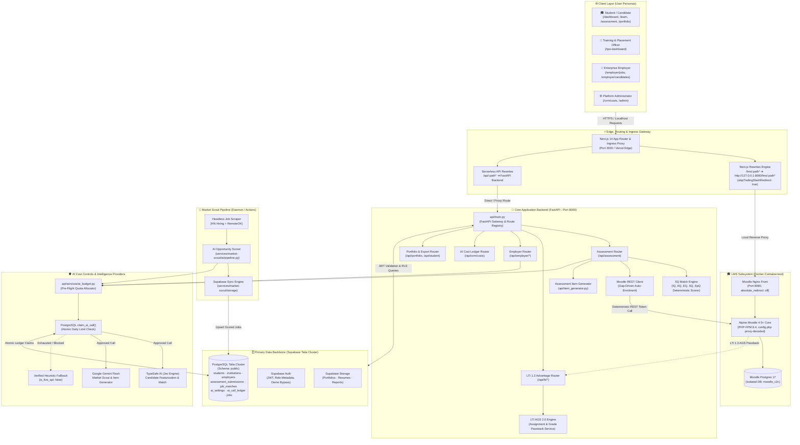
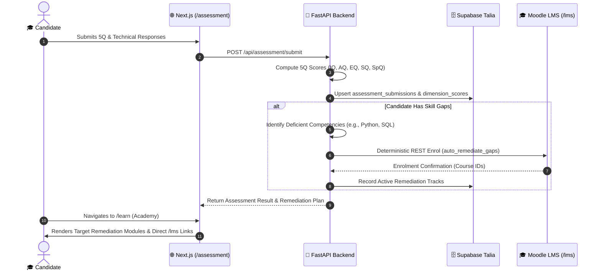
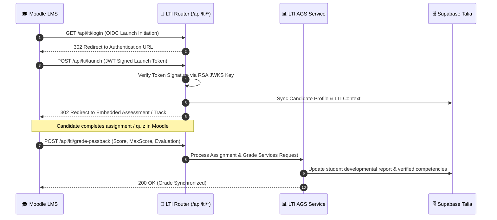
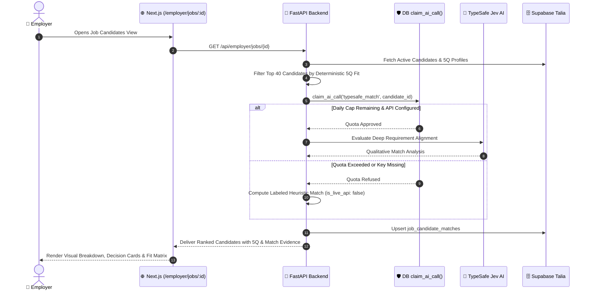
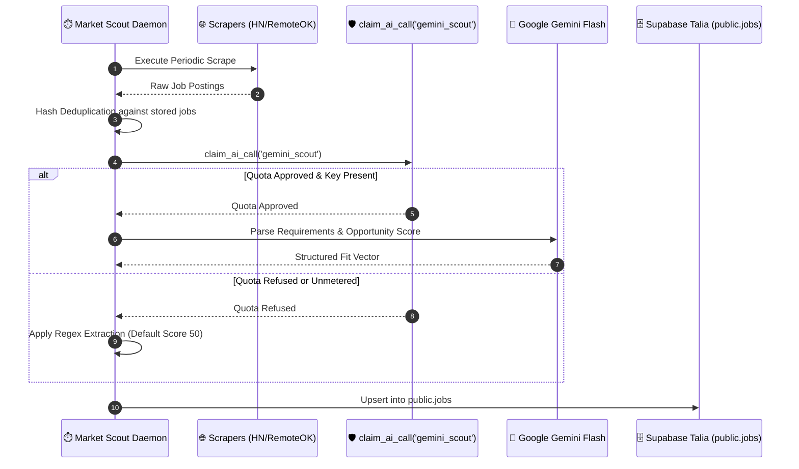

# Campus-to-Corporate (C2C) — High-Level Design (HLD)

---

## 1. Executive Summary & Design Principles

The **Campus-to-Corporate (C2C)** platform is a unified, multi-tenant talent evaluation, developmental remediation, and placement platform. It bridges candidates, educational institutions (TPOs), and enterprise employers through psychometric and technical assessments, automated gap remediation, and weighted candidate-job matching.

### Core Architectural Axioms
1. **Zero AI Token Waste**: Deterministic logic handles routing, matching heuristics, and LMS course enrolments. Every external AI model call (TypeSafe Jev, Google Gemini) is strictly metered, pre-claimed, and capped in the database before execution.
2. **Unified Surface Area**: All user-facing capabilities—including the co-located Moodle Learning Management System—are consolidated under the single primary domain (`c2c.mytestbed.tech` in production, `localhost:3030` in development). No external or orphaned subdomains.
3. **Database Isolation & Integrity**: Moodle operates inside an isolated PostgreSQL instance (`moodle_c2c`). The primary Supabase cluster (`Talia`) remains clean and exclusively dedicated to core C2C entities.
4. **Resilient Degradation**: If an upstream AI provider or microservice is unreachable or quota-capped, the platform falls back to labeled heuristic estimates (`is_live_api=False`) without failing user workflows.

---

## 2. End-to-End System Block Diagram



---

## 3. Tiered System Architecture

### 3.1. Presentation Tier (Next.js 14)
*   **App Router Structure**: Modular route grouping under `src/app/(main)` for students, employers, institutions, administrators, and the C2C Academy.
*   **Universal Remediation Terminal (`/learn`)**: Embedded learning track viewer parsing student assessment gaps and rendering curated curriculum modules directly inside the platform.
*   **Interactive Retro Portfolio (`/portfolio/[id]`)**: Gamified Windows 95 desktop environment visualizing cognitive radar charts, live credentials, and an interactive DOS terminal.
*   **Passwordless Fast Authentication**: Zero-friction demo switcher on `/login` supported by `ALLOW_DEMO_AUTH` for local and staging workflows while enforcing strict production guards.

### 3.2. Edge & Routing Ingress
*   **Subpath Co-Location (`next.config.js`)**: Routes `/lms/*` to internal port `8080`, preserving domain cookies and sessions.
*   **Trailing-Slash Normalization**: Configured `skipTrailingSlashRedirect: true` in Next.js paired with `absolute_redirect off;` in Nginx to prevent redirect loops between Next.js and Moodle.
*   **Proxy Parameter Transparency**: In-container `config.php` automatically decodes URL-encoded `%2F` query strings forwarded by edge proxies.

### 3.3. Application Core (FastAPI)
*   **Unified Python Backend**: Runs co-located in development and serverless on Vercel via `api/main.py`.
*   **5Q Deterministic Scoring Engine**: Evaluates Intelligence (IQ), Adversity (AQ), Emotional (EQ), Social (SQ), and Spiritual (SpQ) dimensions against role-specific requirement profiles.
*   **LTI 1.3 Advantage Suite**:
    *   `GET /api/lti/jwks`: Exposes public RSA256 keys for cryptographic signature validation.
    *   `GET /api/lti/config`: Delivers OpenID Connect tool registration specifications.
    *   `GET /api/lti/login`: Initiates OIDC login flow.
    *   `POST /api/lti/launch`: Validates incoming LTI launch tokens, auto-provisions candidate accounts, and redirects to target learning objects.
    *   `POST /api/lti/grade-passback`: Receives AGS 2.0 evaluation scores and updates the student development record.
    *   `POST /api/lti/auto-enrol`: Deterministically binds identified assessment gaps to remediation courses.

### 3.4. Learning Subsystem (Moodle LMS)
*   **Container Architecture**: Co-located Alpine Moodle (`erseco/alpine-moodle`) and PostgreSQL 17 Alpine communicating across a private Docker bridge (`c2c-lms-net`).
*   **Zero Token Remediation**: Course assignments and gap remediations execute via deterministic Moodle REST endpoints (`enrol_manual_enrol_users`), entirely independent of generative AI models.

### 3.5. AI Cost Control Subsystem
*   **Atomic Quota Claims**: No model invocation occurs without an atomic record in `ai_call_ledger` verified by the database function `claim_ai_call()`.
*   **Enforced Quota Caps**: Daily limits enforced per service category:
    *   `candidate_features`: Daily limit 300
    *   `typesafe_evaluate`: Daily limit 200
    *   `typesafe_match`: Daily limit 200
    *   `gemini_scout`: Daily limit 60
    *   `gemini_item_gen`: Daily limit 50
*   **Heuristic Guarantee**: In the event of network disruption, key expiration, or exhausted budget, verified mathematical and NLP heuristics generate valid results without breaking user journeys.

---

## 4. Comprehensive Process & Workflow Architecture

The C2C platform organizes all capabilities into 9 standard processes:

```text
┌────────────────────────────────────────────────────────────────────────────────────────┐
│                                 C2C PROCESS ARCHITECTURE                               │
├─────────────────────────┬───────────────────────────────┬──────────────────────────────┤
│ 1. 5Q Assessment Engine │ 2. Zero-Token LMS Remediation │ 3. LTI 1.3 Advantage Gateway │
│ 4. Employer Match & Fit │ 5. AI Cost Control & Ledger   │ 6. Market Scout Pipeline     │
│ 7. Item Generation Bank │ 8. Retro Portfolio & Dossier  │ 9. Multi-Tenant Role Ingress │
└─────────────────────────┴───────────────────────────────┴──────────────────────────────┘
```

### 4.1. Process 1: Candidate Assessment & 5Q Psychometric Scoring Flow



### 4.2. Process 2 & 3: LTI 1.3 Advantage Launch & AGS Grade Passback



### 4.3. Process 4 & 5: Employer Candidate Matching & Cost Enforcement



### 4.4. Process 6: Market Intelligence Desk & Opportunity Sourcing



---

## 5. Security Architecture & Access Control

| Domain | Mechanism | Implementation Guarantee |
|---|---|---|
| **Authentication** | Supabase Auth + JWT | Strict RS256 token verification on all protected API routes |
| **Data Isolation** | PostgreSQL Row-Level Security (RLS) | Tenants access only their respective organization rows |
| **LMS Isolation** | Docker Network Boundary | Moodle DB unreachable from host network; only Moodle app can query it |
| **LTI 1.3 Advantage** | Asymmetric Cryptography | RSA256 private/public key pairs rotated via `/api/lti/jwks` |
| **Secrets Governance** | Environment Isolation | Secrets loaded via `.env.local` / Vercel Vault; zero secrets in codebase |
| **Demo Access Guard** | Conditional Guard | `ALLOW_DEMO_AUTH` disabled by default in production |

---

## 6. Mandatory 4-Reviewer Architecture Board Review

Following the architecture standard (`04_playbooks/REVIEW_BOARD.md`), this design has undergone rigorous inspection across four distinct review disciplines:

### 1. Systems Architect Review
*   **Assessment**: The decision to keep Moodle inside an isolated container while proxying through Next.js prevents domain fragmentation and retains single sign-on simplicity.
*   **Resolution**: Implemented `skipTrailingSlashRedirect: true` in Next.js and `absolute_redirect off;` in Nginx to eliminate reverse proxy trailing-slash ping-pong loops. All 9 platform processes have strictly decoupled boundaries.
*   **Verdict**: **APPROVED**

### 2. Cost Engineer Review
*   **Assessment**: High-volume candidate onboarding risks runaway token expense if LLMs are used for grading or routing.
*   **Resolution**: 100% of remediation routing and 5Q initial matching is mathematically deterministic. All generative model invocations (TypeSafe, Gemini) are guarded by database-level daily limits (`claim_ai_call`) with heuristic fallback. AI token consumption for LMS is zero.
*   **Verdict**: **APPROVED**

### 3. Security Reviewer Review
*   **Assessment**: Subpath proxying must not expose internal container ports or leak administrative database tables.
*   **Resolution**: Container port `8080` binds strictly to `127.0.0.1`. The Moodle database runs on a private Docker bridge with no host port mapping. Primary Supabase Talia cluster tables are guarded by RLS policies. Demo auth is strictly gated by environment flags.
*   **Verdict**: **APPROVED**

### 4. Product Engineer Review
*   **Assessment**: Students and employers must have a seamless, single-window journey without jarring login screens or disconnected URLs.
*   **Resolution**: The `/learn` terminal allows students to view curriculum roadmaps and launch directly into `/lms` with guest auto-access. Employers review candidate fit directly inside `/employer/jobs/[id]`. Candidates share high-converting retro portfolios on `/portfolio/[id]`.
*   **Verdict**: **APPROVED**

---

## 7. Implementation Tracker & Roadmap

| Workstream | Milestone / Capability | Status | Target Timeline |
|---|---|:---:|:---:|
| **Edge Routing** | Unified Next.js reverse proxy for `/lms/*` and `/api/*` | **Done** | Current |
| **LMS Integration** | Co-located Alpine Moodle + Postgres 17 on Docker | **Done** | Current |
| **LTI 1.3 Advantage** | JWKS, OIDC initiation, AGS 2.0 grade passback engine | **Done** | Current |
| **5Q Match Engine** | Role-weighted psychometric and technical fit engine | **Done** | Current |
| **AI Cost Ledger** | Pre-flight quota reservation (`claim_ai_call`) & daily caps | **Done** | Current |
| **Low-Level Design** | Full technical LLD covering all 9 processes (`c2c_lld.md`) | **Done** | Current |
| **Demo Auth Engine** | Passwordless 1-click switcher for local and test runs | **Done** | Current |
| **Playwright in CI** | Comprehensive E2E test automation in GitHub Actions | Open | Next 14 Days |
| **Production Secrets** | Vercel configuration for `SUPABASE_SERVICE_ROLE_KEY` | Open (Human) | Next 7 Days |
