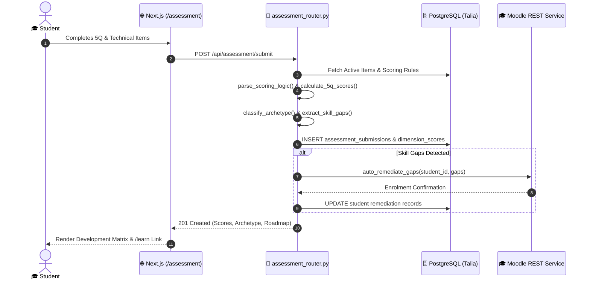
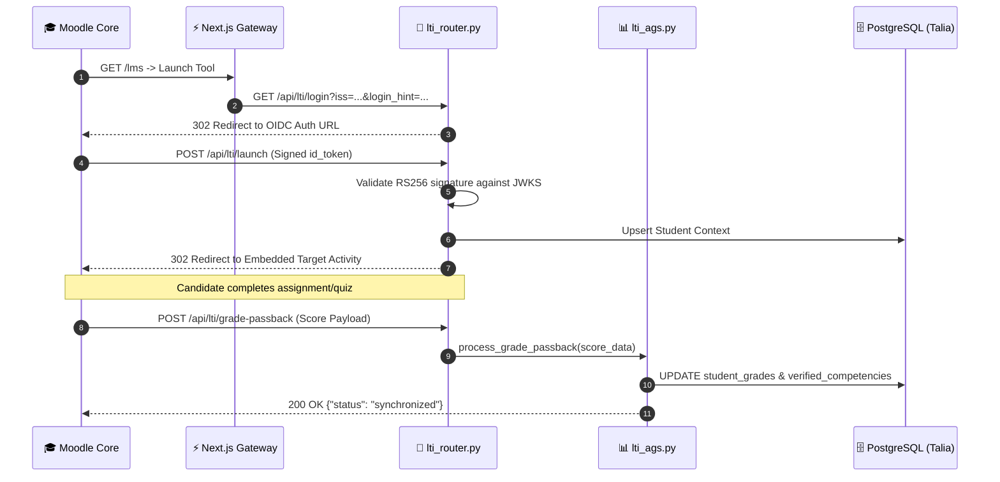
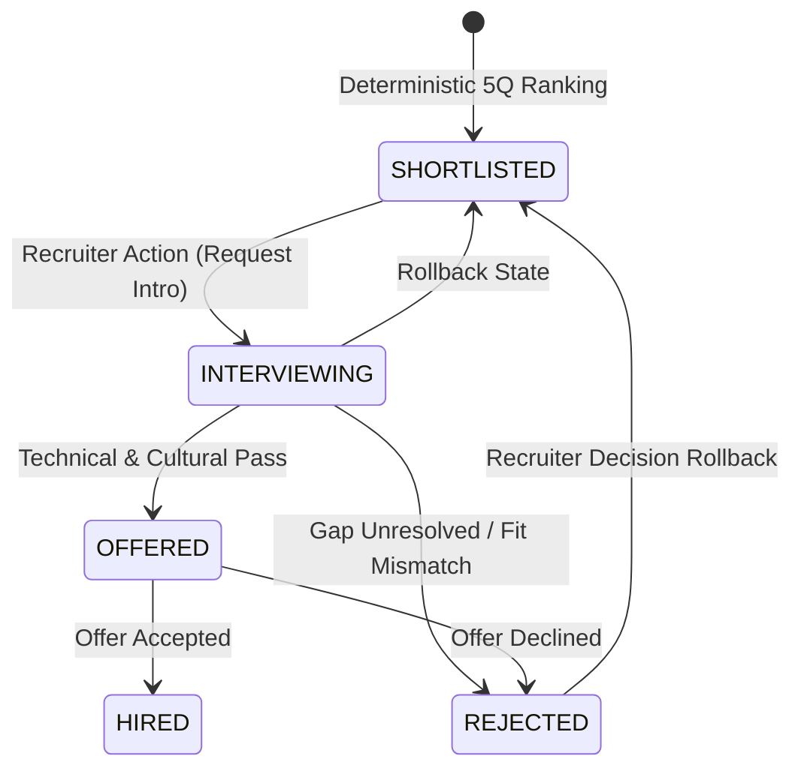

# Campus-to-Corporate (C2C) — Low-Level Design (LLD)

---

## 1. Document Overview & Scope

This Low-Level Design (LLD) document provides exhaustive engineering specifications for all core processes and service workflows within the **Campus-to-Corporate (C2C)** platform. It details module responsibilities, class/function signatures, database schemas, API contracts, deterministic algorithms, state transitions, and error handling policies.

### System Process Catalog
1. **Process 1: Candidate Assessment & 5Q Psychometric Scoring Engine**
2. **Process 2: Automated Gap Remediation & Zero-Token Moodle Enrolment**
3. **Process 3: LTI 1.3 Advantage Gateway & AGS 2.0 Grade Passback**
4. **Process 4: Employer Job Management, Candidate Matching & Decision Pipeline**
5. **Process 5: Deterministic AI Cost Control, Pre-Flight Quota Ledger & Spend Summary**
6. **Process 6: Market Intelligence Desk & Headless Scraping Pipeline (Market Scout)**
7. **Process 7: Assessment Item Generation & Admin Curriculum Authoring**
8. **Process 8: Student Portfolio, Retro Terminal Emulator & Dossier Generation**
9. **Process 9: Multi-Tenant Role Ingress, Authentication & Demo Bypass Guard**

---

## 2. Process 1: Candidate Assessment & 5Q Psychometric Scoring Engine

### 2.1. Module & Component Map
*   **Router**: `api/routers/assessment_router.py`
*   **Schemas**: `api/schemas/assessment.py`
*   **Scoring Service**: `services/matching/scorer.py`, `api/routers/assessment_router.py`
*   **Database Tables**: `public.psychometric_items`, `public.assessment_submissions`, `public.dimension_scores`, `public.assessment_attempts`

### 2.2. Class & Function Signatures
```python
def parse_scoring_logic(logic_str: str, item_type: str) -> Dict[str, Any]:
    """Parses item scoring strings into executable evaluation structures.
    
    Args:
        logic_str: Raw scoring pattern (e.g. 'A: 5, B: 3' or 'High score = high AQ')
        item_type: 'sjt', 'likert', or 'cognitive'
    Returns:
        Dict containing mapping, direction ('forward'|'reverse'), or correct_answer
    """

def calculate_5q_scores(
    responses: List[Dict[str, Any]], 
    items_map: Dict[str, Dict[str, Any]]
) -> Dict[str, int]:
    """Computes normalized integer scores [0-100] across IQ, AQ, EQ, SQ, SpQ.
    
    Args:
        responses: List of question_id and selected option/score
        items_map: Dictionary of question metadata and dimension weights
    Returns:
        Dict mapping 'iq', 'aq', 'eq', 'sq', 'spq' to integer scores
    """

def classify_archetype(scores: Dict[str, int]) -> str:
    """Classifies candidate into a cognitive archetype based on quotient dominance.
    
    Returns:
        'THE_BUILDER' (IQ/AQ dominant) | 'THE_LEADER' (EQ/SQ dominant) | 'THE_ANCHOR' (SpQ/EQ balanced)
    """

def extract_skill_gaps(responses: List[Dict[str, Any]], items_map: Dict[str, Any]) -> List[str]:
    """Identifies deficient skill tokens where score falls below threshold (default 60%)."""
```

### 2.3. Database Schema (PostgreSQL Talia Cluster)
```sql
CREATE TABLE public.psychometric_items (
    id UUID PRIMARY KEY DEFAULT gen_random_uuid(),
    dimension VARCHAR(20) NOT NULL CHECK (dimension IN ('IQ', 'AQ', 'EQ', 'SQ', 'SpQ')),
    item_type VARCHAR(20) NOT NULL CHECK (item_type IN ('likert', 'sjt', 'cognitive', 'open_text')),
    stem TEXT NOT NULL,
    options JSONB,
    scoring_logic TEXT NOT NULL,
    skill_tag VARCHAR(50),
    is_active BOOLEAN DEFAULT TRUE,
    created_at TIMESTAMPTZ DEFAULT NOW()
);

CREATE TABLE public.assessment_submissions (
    id UUID PRIMARY KEY DEFAULT gen_random_uuid(),
    student_id UUID NOT NULL REFERENCES public.students(id) ON DELETE CASCADE,
    answers JSONB NOT NULL,
    raw_scores JSONB NOT NULL,
    archetype VARCHAR(50) NOT NULL,
    gaps TEXT[] DEFAULT '{}',
    created_at TIMESTAMPTZ DEFAULT NOW()
);

CREATE TABLE public.dimension_scores (
    id UUID PRIMARY KEY DEFAULT gen_random_uuid(),
    submission_id UUID NOT NULL REFERENCES public.assessment_submissions(id) ON DELETE CASCADE,
    student_id UUID NOT NULL REFERENCES public.students(id) ON DELETE CASCADE,
    dimension VARCHAR(10) NOT NULL,
    score INT NOT NULL CHECK (score BETWEEN 0 AND 100),
    created_at TIMESTAMPTZ DEFAULT NOW(),
    CONSTRAINT uq_submission_dimension UNIQUE (submission_id, dimension)
);
```

### 2.4. API Request & Response Contracts
*   **Endpoint**: `POST /api/assessment/submit`
*   **Headers**: `Authorization: Bearer <supabase_jwt>`
*   **Request Body**:
```json
{
  "answers": [
    { "question_id": "8b51d8b2-4d1a-4d2b-8a7e-1a8c9e504c21", "response": "A" },
    { "question_id": "c1f7a421-2e11-4f3b-9a4f-5b6d7e8f9a0b", "response": 4 }
  ]
}
```
*   **Success Response (201 Created)**:
```json
{
  "submission_id": "a5e8f490-1c32-47d5-86f2-3e28491d90aa",
  "archetype": "THE_BUILDER",
  "scores": {
    "iq": 84,
    "aq": 78,
    "eq": 62,
    "sq": 55,
    "spq": 70
  },
  "gaps": ["python_async", "sql_window_functions"],
  "remediation_status": "ENROLLED",
  "enrolled_courses": ["C2C-PY-102", "C2C-DB-201"]
}
```
*   **Failure Modes**:
    *   `400 Bad Request`: Empty answers array or invalid question UUID.
    *   `401 Unauthorized`: Missing or expired Supabase JWT token.
    *   `503 Service Unavailable`: PostgreSQL connection failure or agent evaluation unavailable.

### 2.5. Sequence Diagram: Assessment Submission & Evaluation


---

## 3. Process 2: Automated Gap Remediation & Zero-Token Moodle Enrolment

### 3.1. Module & Component Map
*   **Client**: `api/services/moodle_client.py`
*   **Router**: `api/routers/lti_router.py` (`POST /api/lti/auto-enrol`)
*   **Nginx Front**: `services/lms/nginx.conf`
*   **Moodle Core**: `services/lms/docker-compose.yml` (`erseco/alpine-moodle:4.5`)
*   **Database**: Isolated PostgreSQL 17 Alpine (`moodle_c2c`)

### 3.2. Class & Function Signatures
```python
class MoodleClient:
    def __init__(self, base_url: str, token: str):
        self.endpoint = f"{base_url.rstrip('/')}/webservice/rest/server.php"
        self.token = token

    def call(self, wsfunction: str, params: Dict[str, Any]) -> Any:
        """Executes signed deterministic REST calls to Moodle web service."""

    def get_course_by_shortname(self, shortname: str) -> Optional[Dict[str, Any]]:
        """Queries core_course_get_courses_by_field for targeted course."""

    def enrol_user_in_course(self, user_id: int, course_id: int, role_id: int = 5) -> bool:
        """Invokes enrol_manual_enrol_users without consuming generative AI tokens."""

    def auto_remediate_gaps(self, student_email: str, gaps: List[str]) -> List[Dict[str, Any]]:
        """Maps skill gap tokens to Moodle course codes and enrols student."""
```

### 3.3. Deterministic Gap-to-Curriculum Mapping Table
| Gap Token | Moodle Course Shortname | Moodle Course ID | Focus Domain |
|---|---|:---:|---|
| `python_async` | `C2C-PY-102` | 102 | Asynchronous programming & coroutines |
| `sql_window_functions` | `C2C-DB-201` | 201 | Advanced analytical queries & indexing |
| `git_rebase_conflict` | `C2C-GIT-101` | 105 | Interactive rebase & merge dispute resolution |
| `eq_peer_feedback` | `C2C-EQ-301` | 301 | Constructive review delivery & non-violent communication |
| `aq_incident_response` | `C2C-AQ-202` | 202 | PagerDuty triage & post-mortem documentation |

### 3.4. Reverse Proxy Ingress Specification
```nginx
# services/lms/nginx.conf
server {
    listen 8080;
    server_name localhost;
    absolute_redirect off;
    port_in_redirect off;

    location /lms/ {
        alias /var/www/html/;
        try_files $uri $uri/ /lms/index.php?$query_string;
        
        location ~ \.php$ {
            fastcgi_split_path_info ^(.+\.php)(/.+)$;
            fastcgi_pass moodle_app:9000;
            fastcgi_index index.php;
            include fastcgi_params;
            fastcgi_param SCRIPT_FILENAME $request_filename;
            fastcgi_param HTTP_X_FORWARDED_PREFIX /lms;
        }
    }
}
```

---

## 4. Process 3: LTI 1.3 Advantage Gateway & AGS 2.0 Grade Passback

### 4.1. Module & Component Map
*   **Router**: `api/routers/lti_router.py`
*   **AGS Engine**: `api/services/lti_ags.py`
*   **Cryptography**: RSA256 JWKS via `cryptography.hazmat` & `PyJWT`
*   **Database Tables**: `public.lti_deployments`, `public.student_grades`

### 4.2. Endpoints & Protocol Specifications
| Method | Path | Protocol Function | Target Payload / Response |
|---|---|---|---|
| `GET` | `/api/lti/jwks` | JWKS Key Distribution | RSA Public Key (`n`, `e`, `kid: "c2c-lti-v1"`) |
| `GET` | `/api/lti/config` | OIDC Tool Specification | LTI 1.3 Tool Registration JSON |
| `GET` | `/api/lti/login` | OIDC Initiation | 302 Redirect to Platform Auth with `state` & `nonce` |
| `POST` | `/api/lti/launch` | LTI Launch Processing | Validates JWT `id_token`, provisions session |
| `POST` | `/api/lti/grade-passback` | AGS 2.0 Grade Sync | Stores quiz/course score into student development profile |

### 4.3. AGS 2.0 Payload Structure
```json
{
  "timestamp": "2026-11-07T08:15:30Z",
  "scoreGiven": 88.5,
  "scoreMaximum": 100.0,
  "comment": "Completed Python Async Mastery remediation with full test suite pass.",
  "activityProgress": "Completed",
  "gradingProgress": "FullyGraded",
  "userId": "usr_99812401-419b-4b2a-a924-f7b5e4088921",
  "lineItemId": "https://c2c.mytestbed.tech/api/lti/lineitems/course-102"
}
```

### 4.4. Sequence Diagram: LTI 1.3 OIDC Launch & AGS Passback


---

## 5. Process 4: Employer Job Management, Candidate Matching & Decision Pipeline

### 5.1. Module & Component Map
*   **Router**: `api/routers/employer_router.py`
*   **Scorer**: `services/matching/scorer.py`
*   **LLM Match Engine**: `api/services/typesafe_service.py`
*   **Heuristic Fallback**: `api/services/typesafe_heuristics.py`
*   **AI Budget Gate**: `api/services/ai_budget.py`
*   **Database Tables**: `public.employers`, `public.job_postings`, `public.job_candidate_matches`

### 5.2. Role-Weighted 5Q Scoring Formulas
```python
# services/matching/scorer.py
ROLE_WEIGHTS = {
    "technical":  {"iq": 0.40, "aq": 0.30, "eq": 0.20, "sq": 0.05, "spq": 0.05},
    "sales":      {"iq": 0.10, "aq": 0.20, "eq": 0.35, "sq": 0.35, "spq": 0.00},
    "operations": {"iq": 0.30, "aq": 0.25, "eq": 0.25, "sq": 0.15, "spq": 0.05},
    "leadership": {"iq": 0.20, "aq": 0.20, "eq": 0.30, "sq": 0.25, "spq": 0.05},
}

def calculate_match_score(quotients: Dict[str, int], role_category: str) -> float:
    weights = ROLE_WEIGHTS.get(role_category, ROLE_WEIGHTS["technical"])
    score = sum(quotients.get(dim, 50) * weights[dim] for dim in weights)
    return round(score, 2)
```

### 5.3. Matching Pipeline Algorithm (Two-Tier Architecture)
```text
┌────────────────────────────────────────────────────────────────────────┐
│ Tier 1: Deterministic PostgreSQL Filter & 5Q Weighting                │
│ 1. Fetch eligible candidates for job domain.                           │
│ 2. Compute 5Q match score across IQ, AQ, EQ, SQ, SpQ.                  │
│ 3. Rank all candidates; take top 40 candidates.                        │
└────────────────────────────────────────────────────────────────────────┘
                                    │
                                    ▼
┌────────────────────────────────────────────────────────────────────────┐
│ Tier 2: Guarded Deep Evaluation (Top 40 Candidates)                    │
│ For each candidate:                                                    │
│   claim = claim_ai_call('typesafe_match', candidate_id)                │
│   IF claim == APPROVED AND typesafe_configured:                        │
│       result = TypeSafe_Jev.evaluate_candidate_fit(reqs, candidate)    │
│       is_live_api = True                                               │
│   ELSE:                                                                │
│       result = Heuristic_Match.compute_alignment(reqs, candidate)      │
│       is_live_api = False, provider = "Heuristic estimate"             │
│   Persist into job_candidate_matches                                   │
└────────────────────────────────────────────────────────────────────────┘
```

### 5.4. Candidate Status State Machine


### 5.5. API Endpoints
*   `POST /api/employer/jobs`: Create job posting.
*   `GET /api/employer/jobs/{id}`: Returns job details, requirements, and ranked candidate matches with 5Q breakdowns and TypeSafe/Heuristic qualitative fit assessments.
*   `PATCH /api/employer/jobs/{id}/candidates/{student_id}`: Updates match decision status (`SHORTLISTED` | `INTERVIEWING` | `OFFERED` | `REJECTED`) with audit trail.

---

## 6. Process 5: Deterministic AI Cost Control, Pre-Flight Quota Ledger & Spend Summary

### 6.1. Module & Component Map
*   **Router**: `api/routers/costs_router.py`
*   **Service**: `api/services/ai_budget.py`
*   **Advisory**: `api/services/cost_advice.py`
*   **DB Functions**: `claim_ai_call(source, candidate_id)`, `ai_spend_summary(p_days)`
*   **Database Tables**: `public.ai_settings`, `public.ai_call_ledger`

### 6.2. PostgreSQL Atomic Quota Function DDL
```sql
CREATE OR REPLACE FUNCTION public.claim_ai_call(
    p_source VARCHAR(50),
    p_candidate_id UUID DEFAULT NULL
) RETURNS BOOLEAN AS $$
DECLARE
    v_daily_cap INT;
    v_account_cap INT;
    v_daily_spent INT;
    v_account_spent INT;
    v_today_start TIMESTAMPTZ := date_trunc('day', NOW() AT TIME ZONE 'UTC');
BEGIN
    -- Check account-wide ceiling
    SELECT account_max_calls_per_day INTO v_account_cap FROM public.ai_settings LIMIT 1;
    IF v_account_cap IS NOT NULL THEN
        SELECT COUNT(*) INTO v_account_spent 
        FROM public.ai_call_ledger 
        WHERE created_at >= v_today_start;
        IF v_account_spent >= v_account_cap THEN
            RETURN FALSE;
        END IF;
    END IF;

    -- Check source-specific daily ceiling
    EXECUTE format('SELECT %I_max_calls_per_day FROM public.ai_settings LIMIT 1', p_source)
    INTO v_daily_cap;
    
    IF v_daily_cap IS NOT NULL THEN
        SELECT COUNT(*) INTO v_daily_spent 
        FROM public.ai_call_ledger 
        WHERE source = p_source AND created_at >= v_today_start;
        IF v_daily_spent >= v_daily_cap THEN
            RETURN FALSE;
        END IF;
    END IF;

    -- Atomic reservation
    INSERT INTO public.ai_call_ledger (source, candidate_id, created_at)
    VALUES (p_source, p_candidate_id, NOW());
    
    RETURN TRUE;
END;
$$ LANGUAGE plpgsql SECURITY DEFINER;
```

### 6.3. Pre-Flight Reservation Logic (`ai_budget.py`)
```python
def claim_ai_call(supabase_client, source: str, candidate_id: Optional[str] = None) -> bool:
    """Executes pre-execution reservation.
    
    Returns True if quota is available and reserved; False if cap is reached or DB unavailable.
    """
    try:
        res = supabase_client.rpc(
            "claim_ai_call",
            {"p_source": source, "p_candidate_id": candidate_id}
        ).execute()
        return bool(res.data)
    except Exception as e:
        logger.warning(f"Cost control rejection: claim_ai_call failed: {e}")
        return False
```

### 6.4. Cost Advisory Logic (`cost_advice.py`)
*   **Threshold Rule 1 (Saturation)**: If feature consumption exceeds 85% of its daily cap, issue alert to increase quota or enable caching.
*   **Threshold Rule 2 (Zero Utilization)**: If source cap is set but 7-day usage is 0, recommend de-provisioning.
*   **Threshold Rule 3 (Budget Burn Rate)**: If projected monthly spend exceeds `monthly_budget_inr`, generate throttle directive.

---

## 7. Process 6: Market Intelligence Desk & Headless Scraping Pipeline (Market Scout)

### 7.1. Module & Component Map
*   **Scraper Orchestrator**: `services/market-scout/scraper/main.py`
*   **Sources**: `services/market-scout/scraper/sources/hn_hiring.py`, `remoteok.py`
*   **AI Enrichment**: `services/market-scout/ai/pipeline.py` (Gemini Flash)
*   **Budget Guard**: `services/market-scout/ai/budget.py` (`claim_ai_call('gemini_scout')`)
*   **Storage Bridge**: `services/market-scout/storage/supabase_sync.py`
*   **Database Table**: `public.jobs`

### 7.2. Data Flow & Deduplication Pipeline
```text
┌───────────────────────────┐      ┌───────────────────────────┐
│ HackerNews Hiring Scraper │      │ RemoteOK Scraper Engine   │
└─────────────┬─────────────┘      └─────────────┬─────────────┘
              │                                  │
              └─────────────────┬────────────────┘
                                │ Raw Job Postings
                                ▼
              ┌───────────────────────────────────┐
              │ URL & Text Hash Deduplication Gate│
              └─────────────────┬─────────────────┘
                                │ Unique Jobs
                                ▼
              ┌───────────────────────────────────┐
              │ Pre-Claim Quota: 'gemini_scout'   │
              └───────┬───────────────────┬───────┘
          Approved    │                   │ Rejected / Unset
                      ▼                   ▼
    ┌───────────────────────────┐   ┌───────────────────────────┐
    │ Gemini Opportunity Score  │   │ Regex & Heuristic Scorer  │
    │ & 5Q Requirement Parser   │   │ (Score = 50, Status Unset)│
    └─────────────┬─────────────┘   └─────────────┬─────────────┘
                  │                               │
                  └───────────────┬───────────────┘
                                  ▼
              ┌───────────────────────────────────┐
              │ Supabase Talia (public.jobs)      │
              └───────────────────────────────────┘
```

---

## 8. Process 7: Assessment Item Generation & Admin Curriculum Authoring

### 8.1. Module & Component Map
*   **Generator**: `api/item_generator.py`
*   **CLI Script**: `scripts/generate_bank_llm.py`
*   **Fallback Bank**: `api/fallback_bank.json`
*   **Budget Source**: `gemini_item_gen`
*   **Database Table**: `public.psychometric_items`

### 8.2. Item Generation Schema & Fallback Contract
```json
{
  "dimension": "AQ",
  "item_type": "sjt",
  "stem": "Your production deployment encounters a critical deadlock 10 minutes prior to client presentation. What is your immediate action?",
  "options": {
    "A": "Roll back to last stable release and notify stakeholders immediately.",
    "B": "Attempt to debug the live container in production to identify thread locks.",
    "C": "Postpone the meeting citing technical difficulties.",
    "D": "Disable concurrency checks to force presentation passage."
  },
  "scoring_logic": "A: 5, B: 3, C: 2, D: 1",
  "skill_tag": "incident_triage"
}
```
*   **Fault-Tolerance Policy**: If Gemini API returns rate limit (429), invalid JSON, or `claim_ai_call('gemini_item_gen')` returns `False`, the generator automatically injects curated items from `api/fallback_bank.json` with zero system interruption.

---

## 9. Process 8: Student Portfolio, Retro Terminal Emulator & Dossier Generation

### 9.1. Module & Component Map
*   **Router**: `api/routers/portfolio_router.py`, `api/routers/student_router.py`
*   **Frontend**: `src/app/portfolio/[id]/page.tsx`, `src/app/feedback/[id]/page.tsx`
*   **PDF Engine**: `api/pdf_generator.py` (ReportLab / WeasyPrint)
*   **Database Tables**: `public.students`, `public.assessment_submissions`, `public.peer_feedback`

### 9.2. Retro Terminal Protocol (DOS Emulator)
The `/portfolio/[id]` desktop environment includes a mock MS-DOS command interpreter (`terminal.tsx`) exposing deterministic queries:
*   `help`: Displays available commands (`profile`, `scores`, `radar`, `skills`, `clear`).
*   `scores`: Outputs candidate 5Q scores (IQ, AQ, EQ, SQ, SpQ).
*   `radar`: Displays an ASCII rendering of the CogMatrix vector.
*   `dossier`: Initiates a stream download of the cryptographically signed candidate verification PDF (`/api/student/{id}/export`).

---

## 10. Process 9: Multi-Tenant Role Ingress, Authentication & Demo Bypass Guard

### 10.1. Module & Component Map
*   **Dependencies**: `api/deps.py`
*   **Auth Callback**: `src/app/auth/callback/route.ts`
*   **Role Gate**: `require_role(["student" | "employer" | "tpo" | "admin"])`
*   **Database Tables**: `auth.users`, `public.students`, `public.employers`, `public.institutions`, `public.admins`

### 10.2. Production Demo Auth Boundary
```python
# api/deps.py
def get_current_user(request: Request, authorization: Optional[str] = Header(None)):
    allow_demo = os.environ.get("ALLOW_DEMO_AUTH", "false").lower() == "true"
    
    # Strictly prohibited in production environments
    if allow_demo and authorization and authorization.startswith("Bearer demo-"):
        role = authorization.replace("Bearer demo-", "")
        return MockUser(id=f"demo-{role}-id", email=f"{role}@c2c.demo", role=role)

    # Standard Supabase JWT validation path
    token = extract_bearer_token(authorization)
    payload = verify_supabase_jwt(token)
    return payload
```

---

## 11. Comprehensive Error Handling & Fault-Tolerance Policy

| Subsystem | Potential Failure Mode | Detection Vector | Automated Recovery / Fallback |
|---|---|---|---|
| **AI Matching** | TypeSafe Jev API timeout / quota exhaustion | HTTP 504 / `claim_ai_call` returns `False` | Switch to `typesafe_heuristics.py`, return `is_live_api=False` |
| **LMS / Moodle** | Docker container down or port 8080 unreachable | ConnectionRefused / 502 Bad Gateway | Serve cached `/learn` curriculum track; queue enrolment in DB |
| **LTI 1.3** | Mismatched RSA signature or expired token | `jwt.DecodeError` / `ExpiredSignatureError` | Return 401 with structured LTI error redirect to OIDC initiator |
| **Market Scout** | Target job board alters HTML structure | Scraper parsing exception | Log error, skip defective element, process remaining pipeline |
| **Item Gen** | Gemini API unavailable or token cap reached | Gemini Client Exception / Cap `0` | Seamlessly fallback to `api/fallback_bank.json` items |
| **Database** | Supabase connection pooling exhaustion | Postgres connection timeout | Return HTTP 503 with Retry-After header; log connection metrics |

---

## 12. Verification & Testing Matrix

```bash
# 1. Run Complete Backend Unit & Router Test Suite
python -m pytest tests -q --ignore=tests/e2e --ignore=tests/e2e_flow_test.py

# 2. Verify TypeScript Compilation & Static Typing
npx tsc --noEmit

# 3. Verify Frontend Linting & Production Build
npm run lint
npm run build

# 4. Verify Local Moodle Subsystem Status
docker compose -f services/lms/docker-compose.yml ps
```
